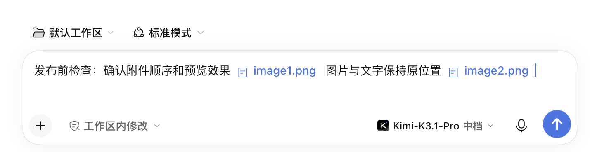
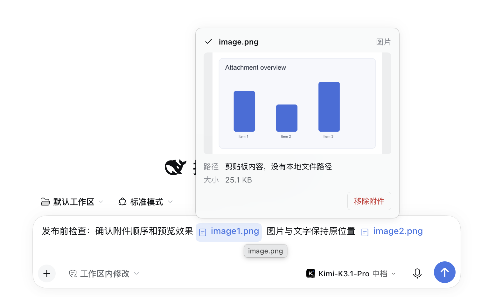
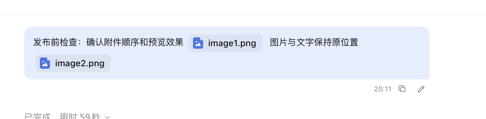

# Inline Attachments for DeepSeek Harness

[简体中文](README.md) | **English**

Improves image and file display in the Harness composer and conversation, with inline numbering, hover previews, one-click copying of historical messages with attachments, and re-editing. The original upload and submission flow is preserved.

> **Status: public Beta.** The current compatibility baseline is DeepSeek Harness `0.2.1-rc.5`. The plugin relies on composer Slots, Lexical reference chips, and attachment APIs; verify it again after upgrading Harness.

## Installation

Download `dsh-inline-attachments-1.0.0-beta.4.tgz` from the [GitHub Release](https://github.com/Zm-nn/dsh-inline-attachments/releases/tag/v1.0.0-beta.4), then choose the local-package installation option in Harness Plugin Manager. Reload or restart Harness when prompted. If the package is published to npm later, it can also be installed as `dsh-inline-attachments@beta`.

## Examples

These screenshots use fictional data in an isolated demo session and contain no real business content. The demo UI is shown in Chinese; the plugin interface follows the Harness language and includes both Chinese and English dictionaries.

### Inline numbering in the composer

Images and files remain at their original positions in the text and use concise numbered names.

### Image hover preview

Hover over an image chip to see its thumbnail, filename, size, and path. Click the thumbnail to open the lightbox.

### Historical messages and quick actions

Attachments remain inline after submission. Copy and re-edit actions are available below the message.

## Features

- Hover over file chips to inspect paths and upload information.
- Hover over image chips to see thumbnails and click to open a larger preview. The preview is rendered directly by the composer component, reuses the current conversation context, and is portaled to `document.body`, avoiding composer clipping and scroll-container offset issues. Message chips and previews share a Store that survives hot updates from other client plugins.
- Removing an attachment from its preview also removes the editor reference and the pending attachment.
- Composer chips use numbered names such as `image1.png` and `file2.xlsx`, following the pending attachment order. Both custom and native attachment references are numbered and recalculated after removals or reordering. Display replacement does not change text offsets or editor references; original filenames remain available in preview details. Numbering runs before browser paint, observes later Lexical chip updates, and reads the latest input snapshot to prevent lag, flicker, and missing numbers.
- Submitted images, files, and text remain inline in the same message bubble. Attachments use compact type-icon and numbered-name chips in Host attachment order; thumbnails are not rendered inside the bubble. Hover to preview submitted attachments, and click an image chip or preview thumbnail to open it through Chat's authorized image loader.
- Pending local echoes use the same inline chip style, preventing native full-size images or raw Chinese position markers from flashing before message admission.
- The Client writes position markers during text serialization, numbered in Host submission order. Before admission, the Host `agent/pre-step` hook converts them into numbered-name text followed by the actual image or file block and stores that order in the Session log. The UI merges each caption with its adjacent attachment into one chip without duplicate rendering. Legacy private markers remain supported; positions cannot be inferred reliably for old messages without markers.
- The user-message copy action writes HTML clipboard content containing attachment references and inline order. Pasting into the composer rereads historical attachments and restores the original text → attachment → text sequence instead of appending every attachment at the end. Restoration registers the complete attachment batch and fixed numbering first, then writes one complete semantic draft with all text, independent attachment references, and correct offsets. Later partial state publications cannot reset existing numbers.
- Clipboard writing has multiple fallbacks: asynchronous HTML first, then `execCommand('copy')` with attachment-aware HTML, and plain text only when both HTML paths fail. The latest copy is also staged in the current tab's `sessionStorage`, allowing attachment recovery after a page reload when only plain text remains on the clipboard. Each new copy replaces the previous staged payload to avoid restoring the wrong message.

## Re-editing historical messages

User messages in completed turns offer a **re-edit** action. Historical text and attachments are restored to the composer in their original order; the user can edit and manually resend them. The plugin never overwrites or resends history automatically. While the Session is running, all historical user messages show copy only; re-edit actions return after the Session stops. Conversation rollback is not provided.

The plugin does not replace the main editor, upload service, or submission service. Historical attachments are read through existing Session-authorized APIs. If image reading fails, the plugin falls back to Chat's authorized image-loading path to obtain the original bytes; files continue to use the Session attachment API. When the source Session is not open, it is temporarily retained for reading and released afterward.

## Model input and UI positions

The Client records attachment order with position markers. During `agent/pre-step`, the Host selects attachments by number, retains short captions such as `【image1.png】` and `【file2.xlsx】` at the same positions, and inserts the actual image or file blocks. New messages are stored as native content in the order text → caption → image/file → text. The model sees both the number and the actual attachment at the corresponding position, and later model requests reconstruct the same order from the Session log.

This conversion applies only to new messages submitted after enabling the plugin; it does not rewrite existing history. It preserves structural order between request content and input positions, but cannot guarantee error-free model reasoning.

## License

MIT License. The plugin does not replace the main editor, upload service, or submission service, and does not upload attachments to external services.
