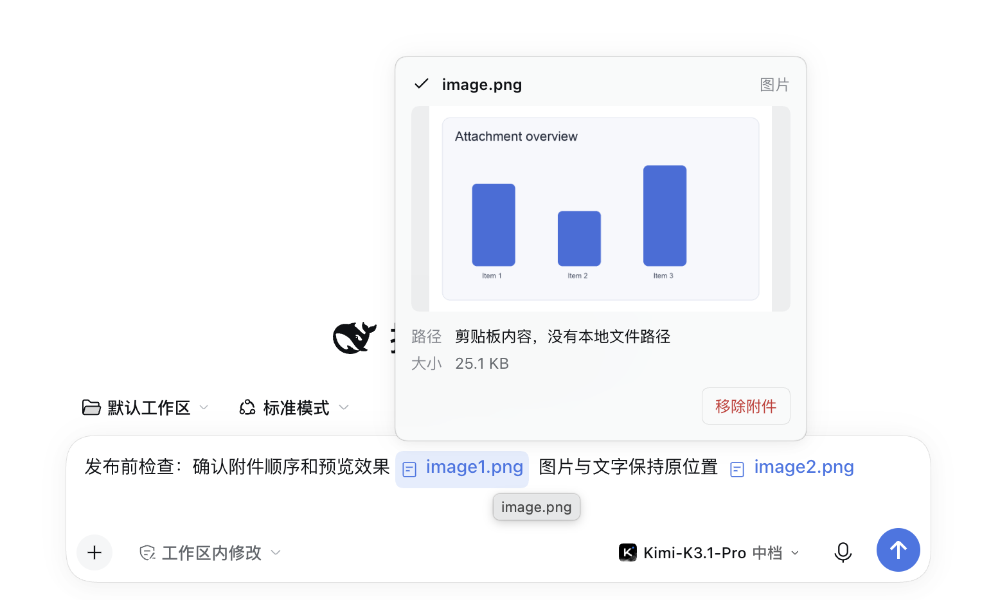

# 输入框优化组件

优化 Harness 对话框中的图片与文件显示，支持内联编号、悬浮预览，以及历史消息文字与附件一键复制和重新编辑，并保留原有上传和发送链路。

> **状态：公开 Beta。** 当前兼容基线为 DeepSeek Harness `0.2.1-rc.5`。插件依赖输入框 Slot、Lexical 引用标签和附件接口，升级 Harness 后需要重新验证。

## 安装

从 [GitHub Release](https://github.com/Zm-nn/dsh-inline-attachments/releases/tag/v1.0.0-beta.4) 下载 `dsh-inline-attachments-1.0.0-beta.4.tgz`，在 Harness 插件管理中选择本地包安装，然后按提示重载或重启 Harness。若以后发布到 npm，也可以使用包名 `dsh-inline-attachments@beta` 安装。

## 示例

以下截图来自独立的演示会话和虚构示例数据，不包含真实业务内容。

### 输入框内联编号

图片和文件直接显示在文字原位置，使用简洁的英文数字短名称。

### 图片悬浮预览

悬浮图片标签即可查看缩略图、文件名、大小和路径，点击缩略图可进入大图。

### 历史消息与快捷操作

发送后的附件保持原位置内联显示；消息下方提供一键复制和重新编辑入口。

## 功能

- 文件标签悬浮显示路径或上传信息。
- 图片标签悬浮显示缩略图，点击进入大图预览；预览由输入框组件直接渲染并复用现有会话上下文，通过 Portal 输出到 `document.body`，不会被输入框裁剪或随滚动容器错位。消息标签与预览共享跨热更新保持的 Store，避免其他客户端插件热更新后预览失效。
- 从标签预览中移除附件时，同时移除编辑器标签和待发送附件。
- 输入框中的图片和文件标签统一显示 `image1.png`、`file2.xlsx` 这类英文数字短名称，编号与待发送附件顺序一致；自定义和原生附件引用都会编号，删除或调整附件后重新编号。显示替换不改变标签文字位置或编辑器引用，原始文件名仍保留在预览信息中。编号在浏览器绘制前同步，并监听 Lexical 后续新增或改写的标签，使用最新输入快照避免延迟、闪烁和漏编号。
- 已发送的图片、文件和文字在同一个消息气泡内联展示；附件统一使用“类型图标 + 英文数字短名称”的胶囊标签，编号与 Host 附件顺序一致，不在气泡内显示图片缩略图。悬浮已发送附件可打开预览，点击已发送图片标签或悬浮缩略图可通过 Chat 的授权图片加载器查看大图。
- 发送中的本地回显也使用相同的内联胶囊样式，避免在消息准入前闪出原生大图或原始中文位置标记。
- 客户端在文本序列化时写入位置标记，编号与 Host 附件提交顺序一致。Host 的 `agent/pre-step` 监听会在消息准入前把标记转换成“英文数字短名称文本 + 真实图片或文件内容块”，并按输入顺序写入会话日志；界面把短名称文本与相邻附件合并成一个胶囊标签，不重复渲染。旧的私有位置标记仍兼容，没有任何位置标记的旧消息无法可靠推断原位置。
- 用户消息的复制按钮会写入包含附件引用及内联顺序的 HTML 剪贴板内容；粘贴回输入框时，重新读取历史附件，并按“文字 → 附件 → 文字”的原顺序恢复，不再统一追加到末尾。恢复时先按完整名单一次性登记全部附件并固定编号，再一次性写入包含全部文字、独立附件引用和正确偏移的完整语义草稿，避免逐段插入造成首个引用丢失或全部标签共用同一编号；后续不完整的状态发布不会重置已有编号。
- 复制采用多级回退：优先使用异步剪贴板 HTML；若浏览器或权限策略拒绝，再通过 `execCommand('copy')` 写入带附件的 HTML；只有 HTML 方式都不可用时才降级为纯文本，并把最近一次复制暂存到当前标签页的 `sessionStorage`，因此页面重载后即使剪贴板只留下文字，粘贴时仍能恢复同一份附件。每个新复制会覆盖旧暂存，避免误把别的消息附件恢复进来。

## 历史消息重新编辑组件

已完成轮次中的用户消息提供**重新编辑**动作：把历史文字和附件按原顺序恢复到输入框，修改后由用户手动重新发送，不会自动覆盖或重发历史消息。只要当前会话仍在运行，所有历史用户消息都只保留复制，不显示编辑按钮；会话停止运行后，编辑按钮恢复。插件不提供对话回退功能。

插件不替换主编辑器、上传服务或发送服务。历史附件通过现有 Session 授权接口读取；图片读取失败时回退到 Chat 授权图片加载链路以取得原始字节，文件仍使用 Session 附件接口。源会话未打开时，会临时保留源会话以完成读取，然后释放该保留。

## 模型输入与界面位置

客户端先用位置标记记录附件顺序。Host 在 `agent/pre-step` 阶段按编号取出对应附件，在相同位置保留 `【image1.png】`、`【file2.xlsx】` 这类英文短名称文本，并插入真正的图片或文件块。新消息因此以原生内容块顺序保存为“文字 → 短名称文本 → 图片/文件 → 文字”，模型既能看到编号，也能在对应位置看到实际附件；后续模型请求从同一会话日志重建这一顺序。

这项转换只处理启用后新提交的消息，不回写已经保存的旧消息。它保证请求内容的结构顺序与输入位置一致，但不保证模型推理绝不出错。

## 许可证

MIT License。插件不替换主编辑器、上传服务或发送服务，也不向外部服务上传附件。
