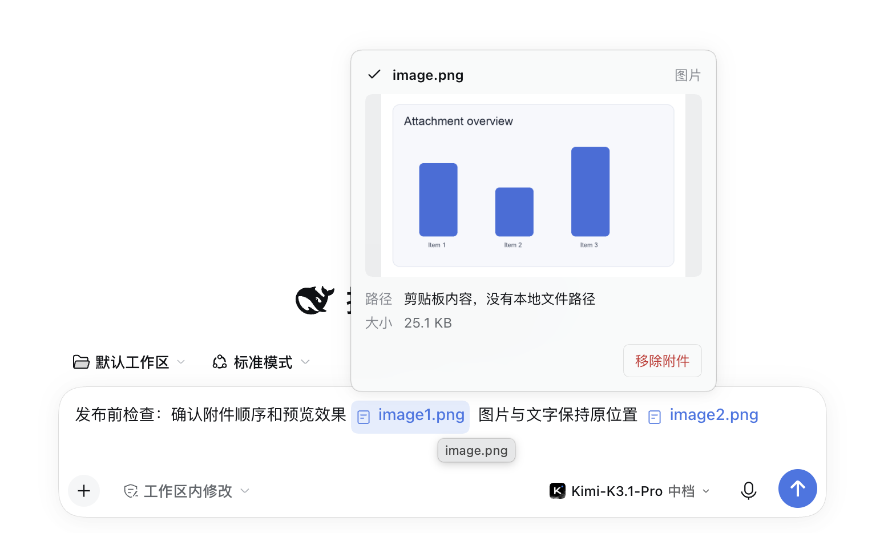

# dsh-inline-attachments 1.0.0-beta.4

[简体中文](https://github.com/Zm-nn/dsh-inline-attachments/blob/main/RELEASE_NOTES.md) | **English**

## Fixes in this release

- Pending local echoes now show inline attachment chips instead of intermittently displaying native full-size images and raw Chinese markers, while preserving local image previews.
- Fixed image hover previews and click-to-open lightboxes after client-plugin hot updates.
- Fixed historical image read failures that prevented copy and re-edit actions from restoring attachments.
- Chinese position markers now accept whitespace between the attachment type and number.

## Examples

The demo UI is shown in Chinese and uses fictional data. The plugin interface follows the Harness language.

### Inline numbering in the composer

### Image hover preview

### Historical messages and quick actions

## Installation

Download `dsh-inline-attachments-1.0.0-beta.4.tgz` from this Release and choose the local-package installation option in DeepSeek Harness Plugin Manager.

## Verification

SHA-256: `bafd6852485d51e2cfb3a47d8b8d282fa05fb4f28b48ea603827f84627a10827`

Compatibility baseline: DeepSeek Harness `>=0.2.1-rc.5 <0.3.0`. Revalidate before installing on other versions.
