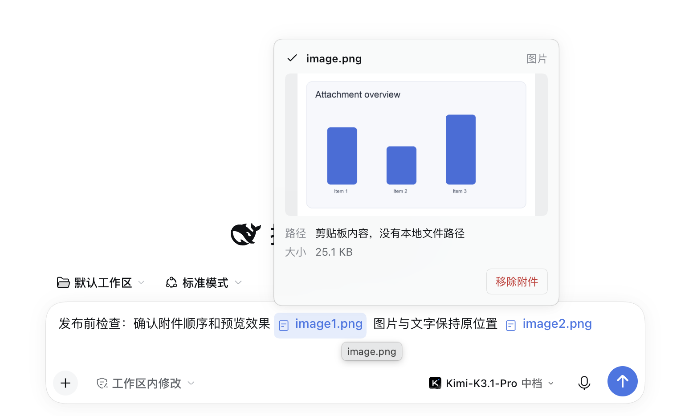

# dsh-inline-attachments 1.0.0-beta.4

## 本版修复

- 修复发送中本地回显偶发展示原生大图和原始中文标记，在原位置显示附件胶囊并保留本地图片预览。
- 修复客户端插件热更新后的图片悬浮预览与点击大图。
- 修复历史图片读取失败导致复制和重新编辑无法恢复附件。
- 中文位置标记兼容类型与编号之间的空白。

## 示例

### 输入框内联编号

### 图片悬浮预览

### 历史消息与快捷操作

## 安装

下载本 Release 中的 `dsh-inline-attachments-1.0.0-beta.4.tgz`，在 DeepSeek Harness 插件管理中选择从本地包安装。

## 校验

SHA-256：`bafd6852485d51e2cfb3a47d8b8d282fa05fb4f28b48ea603827f84627a10827`

兼容基线：DeepSeek Harness `>=0.2.1-rc.5 <0.3.0`。其他版本安装前需要重新验证。
